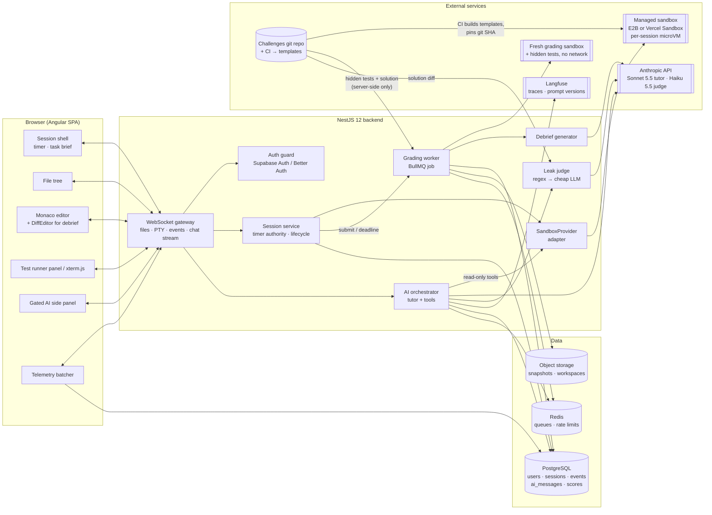

# 04 — Technical Architecture & Tech-Stack Options

> **Task:** T-001 (research phase) · **Written:** 2026-11-11 · **Scope:** architecture and stack options, with trade-offs, for an MVP and for later scaling. 
> **How to read this:** Facts (prices, licences, features) carry a source link and the date the source was checked or published. **Prices and model line-ups in this space change monthly. Re-check every number before committing money.** Anything marked **[Recommendation]** is my own judgement, not a sourced fact.

---

## 0. TL;DR

- **[Recommendation] MVP stack:** Angular SPA + **Monaco** editor + **xterm.js** terminal → **NestJS 12** API/WebSocket gateway → **PostgreSQL** (append-only event log) → **one managed sandbox provider** (E2B or Vercel Sandbox) behind a `SandboxProvider` interface → **Claude Sonnet 5.5** as the gated tutor and **Claude Haiku 5.5** as the leak judge, traced in **Langfuse**. Challenges live in a **git repo** and are pinned by commit SHA.
- **Hidden tests never enter the candidate's sandbox.** Grading runs in a fresh, separate sandbox: the candidate's final workspace plus the hidden tests.
- **The tutor model never sees the reference solution.** Only the judge sees it, and it uses it to detect leaks. This is the main architectural defence for the "never gives the answer" rule.
- **Rough MVP variable cost:** about **$0.45–$0.55 per 45-minute practice session with a Sonnet 5.5 tutor** (range ≈ $0.15 with Haiku 5.5 to ≈ $0.90 with Opus 5.5). The LLM is the largest share with Sonnet or Opus. The sandbox adds about $0.10–$0.15. See §8.
- **Not for the MVP:** WebContainers (needs a commercial licence, Node-only, and the browser runtime would expose grading assets), Judge0/Piston (built for single submissions, not interactive projects), DIY Firecracker (heavy ops work), and local CLI/VS Code delivery (the AI gate can't be enforced). Local delivery is a sensible later add-on.

---

## 1. Requirements that drive the architecture

These come from the product description in TASKS.md (T-001).

| Requirement | Architectural consequence |
|---|---|
| Candidate gets an existing small app with seeded issues | Multi-file workspace, file tree, real language runtime, real test runner (pytest/jest/etc.). A single-file "judge" model isn't enough. |
| IDE-like: file tree, editor, terminal, run tests | Browser editor + PTY terminal over WebSocket + a long-lived per-session sandbox (≈30–90 min). |
| Gated AI that helps but never gives the answer | Server-side LLM orchestration, with tools scoped to the workspace, a separate leak judge, and full transcript logging. The browser never calls the LLM directly. |
| Timed sessions | Server-authoritative clock, deadline enforcement, sandbox TTL slightly longer than the session. |
| Hidden tests + debrief/score | Grading assets kept away from the candidate, a deterministic grading run, and an LLM-written debrief built from telemetry. |
| Score should reflect *how* AI was used | Fine-grained telemetry (edits, test runs, AI turns, pastes, focus) that can be replayed. |

---

## 2. In-browser IDE options

### 2.1 Editor components

| Option | Strengths | Weaknesses | Licence |
|---|---|---|---|
| **Monaco Editor** | The VS Code editor core. Rich IntelliSense (TS/JS out of the box), built-in diff editor, a "model per file" design keyed by URI that maps naturally to a virtual file tree. [pkgpulse, Mar 2026](https://www.pkgpulse.com/guides/monaco-editor-vs-codemirror-6-vs-sandpack-in-browser-2026); [Monaco README](https://cdn.jsdelivr.net/npm/monaco-editor@0.52.0/README.md) | Heavy (several MB, needs lazy loading). The README's FAQ says mobile browsers are **not supported**. [README](https://cdn.jsdelivr.net/npm/monaco-editor@0.52.0/README.md); [pistack, Aug 2026](https://www.pistack.xyz/posts/2026-08-22-browser-code-editors-monaco-codemirror-ace-comparison/) | MIT |
| **CodeMirror 6** | Small and modular (roughly 50–200 kB depending on features). Real touch/mobile support, strong accessibility. [pkgpulse](https://www.pkgpulse.com/guides/monaco-editor-vs-codemirror-6-vs-sandpack-in-browser-2026). Diff via `@codemirror/merge` (side-by-side `MergeView` and inline `unifiedMergeView`), v6.12.1 released Mar 2026. [README](https://cdn.jsdelivr.net/npm/@codemirror/merge@6.12.1/README.md), [changelog](https://cdn.jsdelivr.net/npm/@codemirror/merge@6.12.1/CHANGELOG.md) | No type-aware IntelliSense out of the box (needs an LSP bridge). You build multi-file state yourself. | MIT |
| **monaco-vscode-api (CodinGame)** | Exposes VS Code's API surface on top of Monaco (services, extensions, workbench parts). Latest 34.0.3, last updated Jun 2026. [depscope](https://depscope.dev/pkg/npm/@codingame/monaco-vscode-api) | Large, frequent breaking majors, steep learning curve. | MIT |
| **Sandpack** | Multi-file tabs plus in-browser execution for front-end templates. | Templates that use Nodebox (Node, Vite, Next.js, …) are under a separate EULA that restricts commercial use, and Nodebox isn't open source. [Sandpack FAQ](https://sandpack.codesandbox.io/docs/resources/faq) | Apache-2.0 (Sandpack); Nodebox proprietary |

**[Recommendation]** Use **Monaco** for the MVP. Candidates practise on laptops, real interview platforms (CoderPad, HackerRank) are desktop-first, and the built-in diff editor is useful for the debrief ("your changes vs. starting code"). If mobile review of debriefs matters later, render those read-only views with CodeMirror.

### 2.2 Full IDE in the browser

| Option | Notes |
|---|---|
| **code-server** (Coder) / **OpenVSCode Server** (Gitpod, now Ona) | Full VS Code in the browser, served from inside the sandbox container. Both MIT. About 300–500 MB RAM idle and 1–2 GB under load. They track upstream VS Code within roughly 1–4 weeks. [selfhosting.sh, Feb 2026](https://selfhosting.sh/compare/code-server-vs-openvscode-server/). Both use the **Open VSX** registry, so some Microsoft extensions (Python, C++, Copilot) are missing or outdated. [selfhosting.sh](https://selfhosting.sh/compare/code-server-vs-openvscode-server/); [Ona/Gitpod blog summary](https://www.plushcap.com/content/ona/blog/vscode-server). *(Note: the selfhosting.sh article says OpenVSCode uses the Microsoft marketplace. The Gitpod source says Open VSX. Treat Open VSX as correct.)* |
| **Eclipse Theia** | A framework for building custom IDEs (web or desktop) on VS Code-compatible tech. The quarterly 2026-05 community release bundles 1.69–1.71, and the AI coding features left beta in 1.70. [EclipseSource, Jun 2026](https://eclipsesource.com/blogs/2026/06/19/the-eclipse-theia-community-release-2026-05/) |

**Trade-off:** Serving a full VS Code from the sandbox gives the most realistic IDE for very little UI work. But (a) it roughly doubles sandbox RAM, (b) it is much harder to **control** (extensions, a built-in Copilot/chat surface, telemetry hooks), and (c) the gated-AI panel and timer have to live in a wrapper around it. **[Recommendation]** Don't use it for the MVP. Consider it later as a "pro mode" for long, realistic sessions, with extensions locked down.

### 2.3 Other UI pieces

- **Terminal:** xterm.js (`@xterm/xterm` 6.x) connected over WebSocket to a PTY in the sandbox. Managed sandboxes increasingly ship this. For example, Cloudflare Sandbox added PTY passthrough and an xterm.js addon with reconnect/replay in Feb 2026. [Cloudflare changelog](https://developers.cloudflare.com/changelog/2026-02-09-pty-terminal-support). For the MVP, a **"Run tests" button plus an output panel** may be enough, with a full terminal as a stretch goal.
- **File tree:** build it yourself in Angular (it's simple), backed by the sandbox filesystem API. Keep Monaco models in sync by path.
- **Diff view:** Monaco `DiffEditor` (debrief), or CodeMirror `MergeView`.

---

## 3. Code execution / sandboxing

### 3.1 What we need from a sandbox

1. Run an **untrusted, multi-file project** with real toolchains (Python + pytest, Node + jest/vitest, later Java/Go).
2. Stay alive for the **whole session** (45–90 min), with low cold start and preferably pause/resume.
3. Give us a filesystem API (read/write files), exec, and ideally a PTY.
4. **Security:** strong isolation and egress control (block exfiltration and outbound calls to other LLM APIs during the session).
5. Predictable **per-session cost**.

### 3.2 Options compared

Prices are list prices. Always re-check.

| Option | Isolation | Languages | Session length / cold start | Price signal (dated) | Fit |
|---|---|---|---|---|---|
| **E2B** (managed) | Firecracker microVMs. Core stack is Apache-2.0 and self-hostable ("E2B Embed" single node, or BYOC). [e2b open-source](https://e2b.dev/open-source.md) | Any (custom templates from Dockerfiles) | Hobby: 1 h max continuous runtime. Pro: 24 h. Pause/resume resets the limit. Concurrency: Hobby 10, Pro 100 included. [E2B billing docs](https://docs.e2b.dev/billing.md) | $0.000014/vCPU-s + $0.0000045/GiB-s, so 2 vCPU/0.5 GiB ≈ $0.11/h. [E2B price FAQ](https://docs.e2b.dev/faq/calculate-sandbox-price.md). Pro plan $150/mo, Hobby $0 with $100 one-time credit. [billing](https://docs.e2b.dev/billing.md) (checked 2026-11-11) | **Strong.** Purpose-built, good SDKs (TS/Python), open-source exit path. |
| **Vercel Sandbox** | Firecracker microVMs. [Vercel KB ref.](https://vercel.com/docs/sandbox/pricing.md) | Any (custom images) | Hobby 45 min max session (too short for long sessions). Pro 24 h. Pro concurrency 10,000. | Active CPU $0.128/h (bills only while CPU is busy) + memory $0.0212/GB-h + $0.60 per 1M creations. Hobby includes 5 CPU-h and 420 GB-h per month. Pro usage draws on a $20/mo credit. [Vercel docs, updated 2026-09-10](https://vercel.com/docs/sandbox/pricing.md) | **Strong**, and cheapest for "mostly idle" sessions (a human typing). Hobby's 45-min cap rules out long sessions on the free tier. |
| **Daytona** | Containers/VM sandboxes | Any | Claims sub-90 ms creation | $0.0504/vCPU-h + $0.0162/GiB-h, per-second billing, $200 free compute. [Daytona pricing](https://www.daytona.io/pricing) (checked 2026-11-11) | Good price. **Note:** Daytona moved core development to a private codebase in Jun 2026. The last OSS release (AGPL-3.0) lives on as the community fork "Nightona". [Nightona README](https://cdn.jsdelivr.net/gh/nightona-co/nightona@main/README.md). Weaker open-source exit path than E2B. |
| **Modal Sandboxes** | gVisor. [rywalker, Jun 2026](https://rywalker.com/research/modal) | Any (Python-centric SDK, JS SDK exists) | Sub-second container starts | ~$0.19/h for 2 vCPU/2 GB per Fly's comparison. Bills the *higher* of requested or used resources. Team plan $250/mo. [Fly.io comparison, Sep 2026](https://fly.io/learn/ai-sandbox-pricing/) | OK. Best if we also run Python ML jobs. |
| **CodeSandbox SDK → Together Code Sandbox** | microVMs, snapshot/fork | Any | — | Credits at $0.01486. "Nano" (2 cores/4 GB) ≈ $0.149/h, per-minute billing. [CSB SDK pricing](https://codesandbox.io/docs/sdk/pricing). Together now positions `@codesandbox/sdk` as **legacy**, and new access to `together-sandbox` goes through sales. [Together docs](https://docs.together.ai/docs/together-code-sandbox) | Product in transition. **Avoid for the MVP.** |
| **Cloudflare Sandbox / Containers** | Containers on Cloudflare's network. GA Apr 2026. [CF changelog](https://developers.cloudflare.com/changelog/2026-04-13-containers-sandbox-ga) | Any (container images) | PTY/xterm support built in | Needs Workers Paid ($5/mo). $0.000020/vCPU-s (active only) + $0.0000025/GiB-s + disk. Instance sizes from 1/16 vCPU up to 4 vCPU/12 GiB. [CF Containers pricing](https://developers.cloudflare.com/containers/platform/pricing/) (checked 2026-11-11) | Good. Workers/Durable Objects programming model, so less natural with NestJS. |
| **Fly Machines / Sprites** | Firecracker microVMs | Any | Per-second billing. Sprites pause about 30 s after activity stops. [Fly comparison](https://fly.io/learn/ai-sandbox-pricing/) | shared-cpu-2x/2 GB ≈ $13.39/mo if always on (≈ $0.019/h). Stopped machines pay only rootfs storage at $0.15/GB-mo. [Fly docs](https://docs.fly.io/about/pricing) | Very cheap raw compute, but you write more orchestration yourself (PTY, file API, lifecycle). |
| **DIY Docker-per-session on a VPS** | Shared host kernel. Fine for trusted code, weak for untrusted code unless hardened (seccomp, read-only rootfs, no egress) or run under **gVisor** (`runsc`). [Fly: Firecracker vs gVisor, Sep 2026](https://fly.io/learn/firecracker-vs-gvisor/) | Any | You build everything | Cheapest per hour at steady load. But Hetzner, the usual budget host, raised cloud prices twice in 2026 (Apr and Jun, CPX +144–175%), and cheap CX/CAX plans were often unorderable in Oct 2026. [bitdoze](https://www.bitdoze.com/hetzner-cloud-cost-optimized-plans/) | **Not for the MVP.** Ops and security burden falls on a solo developer. |
| **DIY Firecracker** | Strongest boundary, needs KVM/bare metal, jailer, snapshot care. [Fly](https://fly.io/learn/firecracker-vs-gvisor/) | Any | ~125 ms boot | Hardware cost only | Scale-stage option only (or self-hosted E2B). |
| **Judge0** | Docker + isolate. GPL-3.0. Sandbox-escape CVEs in 2024 (CVE-2024-28185/28189). [GitHub](https://github.com/judge0/judge0) | 75+ languages. Supports multi-file. [pistack](https://www.pistack.xyz/posts/self-hosted-code-execution-sandbox-judge0-piston-runtipi-guide-2026/) | Per-submission, not per-session | Self-host | **Poor fit.** Built for "submit, run, get stdout". No persistent workspace, no PTY, no package installs. |
| **Piston** | Docker + cgroups/seccomp | 40+ languages | Per-submission | Self-host | **Poor fit**, same reasons. |
| **WebContainers (StackBlitz)** | Runs Node.js *in the user's browser* (WASM) | **Node/JS only** | Instant, no server cost | **Commercial for-profit production use needs a paid licence.** No public price; contact sales. Prototypes/POCs are exempt. [webcontainers.io/enterprise](https://webcontainers.io/enterprise); [aicoolies, verified Sep 2026](https://aicoolies.com/pricing/webcontainers). Full support only on Chromium. Safari is beta, Firefox alpha. Requires cross-origin isolation. [browser support](https://webcontainers.io/guides/browser-support) | **Not for the MVP.** Licence cost unknown, JS-only, and everything in the browser can be read by the candidate, so hidden tests and the solution must not ship to it. |
| **Pyodide** | CPython compiled to WASM, in the browser | **Python only** (pure-Python plus a curated set of compiled packages) | Instant after download | Free. v314.0 (Jun 2026) aligned version numbers with Python and allows direct PyPI deployment (PEP 783). [fooqux](https://fooqux.com/article/5738). `pytest-pyodide` exists. [PyPI](https://pypi.org/project/pytest-pyodide) | Possible **free/offline tier** for Python-only katas. Same problem: no hidden assets client-side. No subprocesses or real network. |

### 3.3 Billing-model insight

A practice session is mostly **a human reading and typing**, so CPU is idle more than 90% of the time. Providers that bill **active CPU** (Vercel Sandbox, Cloudflare, Fly Sprites) are cheaper for this workload than wall-clock-on-reserved-resources providers (E2B, Daytona, Modal). The Fly comparison makes the same point about utilisation deciding cost. [Fly.io, Sep 2026](https://fly.io/learn/ai-sandbox-pricing/). Memory is billed for the whole lifetime everywhere, so **keep sandboxes at 2–4 GB**.

### 3.4 Security and integrity checklist (applies to every option)

- **[Recommendation]** **Hidden tests and the reference solution never touch the candidate sandbox.** At grading time, snapshot the candidate's files, start a *fresh* grading sandbox from the challenge template, copy in candidate files plus hidden tests, and run with a timeout and no network.
- **Egress policy:** allow the package registry mirror only while building the template. At runtime, deny all egress (or allow-list), so the sandbox can't call outside LLM APIs or exfiltrate data.
- **Time/CPU/memory limits** on every exec. Kill the sandbox at deadline + grace period.
- **No secrets inside the sandbox.** LLM calls go from NestJS, never from the sandbox.
- **Pre-bake dependencies** into templates/snapshots, so `npm install` / `pip install` at session start isn't needed (faster cold start, fewer supply-chain surprises).

**[Recommendation]** For the MVP, choose **E2B** (mature SDK, open-source exit path, Firecracker isolation) or **Vercel Sandbox** (cheapest for idle-heavy sessions, 24 h sessions on Pro, Firecracker). Hide either behind a `SandboxProvider` interface (`create(template)`, `writeFiles`, `readFile`, `listFiles`, `exec`, `openPty`, `snapshot`, `destroy`) so you can switch later. Confirm before choosing: does Vercel's Pro plan suit a non-Vercel-hosted app? Is E2B's $150/mo Pro needed for more than 1 h sessions (Hobby caps continuous runtime at 1 h)?

---

## 4. Alternative delivery: local CLI / VS Code extension / MCP

### 4.1 What it would look like

- A **CLI** (`trainer start <challenge>`) downloads the starter repo, starts a timer, runs visible tests locally, and uploads the final diff for server-side hidden-test grading.
- The **gated AI** ships as either:
  - a **VS Code extension** with its own webview chat panel that calls our backend. VS Code's AI extensibility now favours *language model tools* and *MCP servers*, and **chat participants are deprecated** for the Copilot harness. [VS Code AI extensibility docs](https://code.visualstudio.com/api/extension-guides/ai/ai-extensibility-overview). A custom webview panel avoids that dependency.
  - an **MCP server** that the candidate plugs into their own agent (Claude Code, Cursor, etc.). The MCP 2026-07-28 spec made the protocol stateless, which simplifies remote servers, and tightened OAuth. [MCP blog](https://blog.modelcontextprotocol.io/posts/2026-07-28/)

### 4.2 Pros and cons vs. the web app

| | Web app | Local CLI / extension / MCP |
|---|---|---|
| Realism (own editor, keybindings, debugger) | Medium | **High** |
| Infra cost | Sandbox ≈ $0.05–0.15/session | **≈ $0** compute |
| **AI gating integrity** | **Enforceable.** The only AI is ours, and egress is blocked. | **Not enforceable.** The candidate can open Copilot, ChatGPT, or any other agent. An MCP server is just one tool among many. |
| Telemetry for scoring | Complete (every edit, run, and AI turn) | Partial (only what the extension sees; nothing from outside tools) |
| Setup friction | Zero (open a URL) | Toolchain install, OS differences, "works on my machine" |
| Hidden-test secrecy | Server-side | Still server-side (upload diff), workable |
| Matches how real AI-assisted interviews run | Meta and LinkedIn use browser-based CoderPad with a built-in AI panel and a fixed model menu. Uber uses HackerRank. [Hello Interview](https://www.hellointerview.com/learn/ai-coding/overview/interview-formats) | Some companies (Shopify, Canva, Rippling) let candidates use their own IDE and AI with screen sharing. [Hello Interview](https://www.hellointerview.com/learn/ai-coding/overview/interview-formats) |

**[Recommendation]** Use the **web app for the MVP**: gating is the core value proposition, and only the web app can enforce it. Add **"BYO-editor practice mode"** (CLI + MCP server, unscored or "honour-system" scored) later, to train for the open-ended interview formats.

---

## 5. LLM layer

### 5.1 Provider options and prices (per 1M tokens, standard tier)

| Provider / model | Input | Cached input | Output | Source (checked) |
|---|---|---|---|---|
| **Claude Opus 5.5** | $4 | $0.20 (5-min write $5) | $20 | [Claude pricing](https://platform.claude.com/docs/en/about-claude/pricing) (2026-11-11) |
| **Claude Sonnet 5.5** | $2 | $0.10 (5-min write $2.50) | $10 | same |
| **Claude Haiku 5.5** (≤100K prompt) | $0.10 | $0.01 | $0.50 | same. Prompts over 100K tokens cost more. |
| OpenAI gpt-6.1-sol | $2.00 | $0.10 | $10.00 | [OpenAI pricing](https://developers.openai.com/api/docs/pricing) (2026-11-11) |
| OpenAI gpt-6.1-terra | $1.00 | $0.05 | $5.00 | same |
| OpenAI gpt-6-luna | $0.10 | $0.01 | $0.50 | same |
| Google Gemini 3.5 Flash | $1.50 | $0.15 (+ storage/h) | $9.00 | [Gemini pricing](https://ai.google.dev/gemini-api/docs/pricing) (2026-11-11) |
| Google Gemini 3.1 Flash-Lite | $0.25 | $0.025 (+ storage/h) | $1.50 | same. Free-tier data may be used to improve Google products, paid-tier data isn't. |
| Open weights: gpt-oss-120b on Groq | $0.15 | — | $0.60 | [computeprices, 2026-11-11](https://computeprices.com/providers/groq/models/gpt-oss-120b) |

Batch APIs are about 50% off on all three major providers (same sources). That's useful for offline debrief generation and judge re-evaluation, not for live chat.

**Claude prompt caching details** ([docs](https://platform.claude.com/docs/en/build-with-claude/prompt-caching), checked 2026-11-11): the minimum cacheable prefix is **512 tokens** for Haiku/Sonnet/Opus 5.5. TTL is 5 minutes (refreshed on every hit) or 1 hour (2× write cost). Up to 4 breakpoints. An **automatic caching** mode moves the breakpoint forward as the conversation grows. Cache order is tools → system → messages. This suits us well: the system prompt + challenge brief + file tree + tool definitions form a stable prefix that is reused every turn.

### 5.2 Gated-AI architecture

**[Recommendation]** All of this runs in NestJS. The browser only sees the streamed, already-approved text.

1. **Tutor model** (Sonnet 5.5 default, Haiku 5.5 for a cheap tier). Its context is the system policy, the challenge brief, the **hint ladder and misconception notes written by the challenge author**, and the conversation. **It does *not* get the solution patch.** A model that never sees the answer can't leak it verbatim, and it can still steer using the misconception notes.
2. **Tools for the tutor**, executed server-side against the session sandbox: `list_files`, `read_file(path, range)`, `search(pattern)`, `get_last_test_output`, `get_recent_diff`. Read-only: **no write or exec tools**. The tutor can look at the candidate's code but can't edit it.
3. **Leak judge** (Haiku 5.5 or similar cheap model). It sees the reference solution diff, the issue list, and the tutor's draft reply, and classifies it as `ok | too_specific | leaks_solution | off_policy`. If flagged, regenerate with a stricter instruction or replace with a generic nudge.
   - **Latency pattern:** run cheap regex/AST checks first (e.g. "reply contains a code block that matches lines in the solution patch"), then the LLM judge. Write-ups on guardrail latency recommend tiered cascades, parallel checks, and checking streamed output in chunks with early termination, keeping expensive judges for ambiguous cases. [Tian Pan, Apr 2026](https://tianpan.co/blog/2026-04-16-safety-layer-latency-guardrails-design)
   - **MVP simplification:** buffer the tutor's full reply (typically 100–300 tokens, a few seconds), judge it, then stream it to the UI. Add chunked streaming checks later.
4. **Evidence that prompt-only gating isn't enough:** CS50's AI "duck" found code blocks in 22% of messages even with a teaching-oriented system prompt, and the rate *rose* with a newer model (GPT-4 → GPT-4o: 20% → 25% of messages). The authors attribute this to long system prompts being followed less reliably ("instruction dilution"). Few-shot examples and fine-tuning helped. [Liu et al., SIGCSE TS 2025](https://cs.harvard.edu/malan/publications/fp0627-liu.pdf). **Implication:** keep the tutor's system prompt short, add few-shot examples, and enforce the rules *outside* the prompt with the judge.
5. **Rate limits / budgets** per session: maximum AI turns, maximum tokens, cooldowns. These are themselves part of the training.

### 5.3 SDK choice

- **Anthropic SDK directly (TypeScript)** in NestJS: the most control over caching, tool use, and streaming.
- **Vercel AI SDK** (provider-agnostic). **v7 shipped 25 Jun 2026**, so v6 code needs a codemod migration. [alexcloudstar, updated Oct 2026](https://www.alexcloudstar.com/blog/ai-sdk-v6-developer-guide-2026/); [Vercel blog](https://vercel.com/blog/ai-sdk-7). It has an **Angular** package (`@ai-sdk/angular`, with a signals-backed `Chat` class) that can point at any backend endpoint through its transport API. [ai-sdk.dev Angular guide](https://ai-sdk.dev/docs/getting-started/angular). The core runs in any Node runtime, so NestJS works. *To verify:* how Anthropic `cache_control` passes through AI SDK provider options.
- **[Recommendation]** Use the Anthropic SDK behind our own `LlmProvider` interface for the MVP (simpler, full caching control). Use plain SSE or Socket.IO to stream to Angular. Revisit AI SDK if you want multi-provider model choice. Offering a model menu would mirror Meta's CoderPad, which lets candidates pick from several providers. [Hello Interview](https://www.hellointerview.com/learn/ai-coding/overview/interview-formats)

### 5.4 Observability of AI transcripts

- **Langfuse:** the open-source version is **MIT** with core tracing, evals, prompt management, and datasets free to self-host (needs ClickHouse). [Langfuse self-host pricing](https://langfuse.com/pricing-self-host.md). Cloud plans: Hobby $0 (50k units, 30-day retention), Core $29, Pro $199. Each trace, observation, and score counts as a unit. [activepieces, Nov 2026](https://www.activepieces.com/blog/langfuse-pricing-plans-and-what-you-pay-in-2026.md)
- **[Recommendation]** Store the **canonical transcript in our own Postgres** (it's product data used for scoring and replay). Send traces to **Langfuse Cloud Hobby** for debugging, prompt versioning, and judge evals. At roughly 50–100 units per session, the free tier covers about 500–1,000 sessions a month.
- Version every prompt (tutor, judge, debrief) and record the prompt version on each AI message, so score drift can be traced to prompt changes.

---

## 6. Backend, data, auth, challenge storage

### 6.1 Framework

| Option | For | Against |
|---|---|---|
| **NestJS 12** (released 27 Aug 2026, latest 12.4.2 on 9 Nov 2026; v11 gets security fixes only) [endoflife.date](https://endoflife.date/nestjs) | The owner's core skill. One TypeScript language with the Angular frontend (shared DTO/types). First-class WebSocket gateways, guards, and queues (BullMQ). E2B, Vercel, and Anthropic all have official TS SDKs. | Python ML tooling (if used for scoring analytics) would live in a separate service. |
| FastAPI | The owner knows Python. Natural for ML/analytics. | Two languages across the stack. Slower for a solo developer to keep the front and back in sync. |

**[Recommendation]** Use **NestJS** for the MVP. Add a small **Python worker** later only if scoring analytics need pandas/scikit-learn.

### 6.2 Database: PostgreSQL schema sketch **[Recommendation]**

```
users(id, email, name, created_at, plan)
auth_* (managed by auth library/provider)

challenges(id, slug, title, language, difficulty, tags[])
challenge_versions(id, challenge_id, git_sha, template_id,   -- sandbox template/snapshot id
                   time_limit_s, rubric jsonb, hint_ladder jsonb,
                   visible_tests_path, hidden_tests_ref, solution_ref, published_at)

sessions(id, user_id, challenge_version_id, status, started_at, deadline_at,
         ended_at, sandbox_id, final_snapshot_ref, client_info jsonb)

session_events(id bigserial, session_id, seq int, ts timestamptz,
               kind text,        -- edit|file_open|file_create|run_tests|terminal_cmd|
                                 -- ai_user_msg|ai_reply|paste|focus|blur|timer|submit
               payload jsonb)    -- append-only; partition by month when large
  UNIQUE(session_id, seq)

file_snapshots(session_id, seq, path, content_hash, blob_ref)   -- at each test run + submit
test_runs(id, session_id, seq, kind visible|hidden, passed, failed, results jsonb, duration_ms)

ai_messages(id, session_id, seq, role, content, model, prompt_version,
            input_tokens, cached_tokens, output_tokens, latency_ms,
            judge_verdict, judge_reason, regenerated bool)

scores(session_id, hidden_pass_rate, rubric_scores jsonb, ai_usage_metrics jsonb,
       total, scorer_version)
debriefs(session_id, content_md, model, prompt_version, created_at)
```

- Use **JSONB** for event payloads and an index on `(session_id, seq)`. Postgres handles the MVP easily. Move high-volume events to ClickHouse or Timescale only at scale.
- Store large blobs (file snapshots, final workspaces) in **object storage** (S3/R2/Supabase Storage), addressed by content hash.
- **Hosting:** Supabase Pro is **$25/mo including $10 compute credit** (Micro, 1 GB). [Supabase KB](https://supabase.com/kb/faqs/platform/database-only-cost). Neon is usage-based with no minimum on paid tiers. [activepieces, Nov 2026](https://www.activepieces.com/blog/neon-pricing-2026-plans-free-tier-limits-and-costs.md)

### 6.3 Auth

| Option | Notes (per [alexcloudstar, Apr/Oct 2026](https://www.alexcloudstar.com/blog/better-auth-vs-clerk-vs-supabase-auth-2026/)) |
|---|---|
| **Better Auth** | Open source, free, users live in your own DB, least lock-in. You build the UI and run it yourself. |
| **Clerk** | Best prebuilt UI and orgs features. Per-MAU pricing grows with usage, higher lock-in. |
| **Supabase Auth** | Included in Supabase's flat pricing, Postgres RLS integration, basic org features. |

**[Recommendation]** If you host the DB on Supabase, use **Supabase Auth** (no extra vendor; NestJS verifies the JWT). Otherwise use **Better Auth**. Clerk becomes worth it only when B2B org/SSO features matter.

### 6.4 Storing challenge repos **[Recommendation]**

- One private **`challenges` git repo**: `challenges/<slug>/{starter/, tests/visible/, tests/hidden/, solution.patch, meta.yaml (rubric, hint ladder, misconceptions, time limit, seeded-issue list)}`.
- **CI pipeline** on merge: (1) apply `solution.patch` and confirm all hidden tests pass; (2) confirm the starter *fails* the expected tests (each seeded issue is detectable); (3) build the sandbox template/snapshot with dependencies pre-installed; (4) upsert a `challenge_versions` row pinned to the **git SHA**.
- Sessions reference `challenge_version_id`, so editing a challenge never changes past scores.
- Hidden tests and the solution are fetched only by the grading worker and the judge (server-side), never by the candidate sandbox or the browser.

---

## 7. Telemetry for scoring and replay **[Recommendation unless cited]**

| Signal | How to capture | Scoring use |
|---|---|---|
| Edits | Monaco `onDidChangeModelContent` deltas, batched every 1–2 s with a monotonic `seq` | Timeline, churn, "time to first meaningful edit" |
| Pastes | Monaco paste event + size | Large pastes after AI replies show copy-paste reliance (gated AI shouldn't give code anyway) |
| File navigation | file_open / focus events | Did they explore the codebase before changing it? |
| Test runs | Server-side (we run them), with results and a snapshot | Hypothesis → test loop, regressions |
| Terminal commands | Commands sent through the PTY (server-side) | Debugging practice |
| AI interactions | Server-side `ai_messages` with judge verdicts | Prompt quality, over-reliance, "asked for the answer" attempts |
| Tab focus/blur | `visibilitychange` | Rough off-platform time (an honest signal, not proctoring) |

- **Replay:** fold edit deltas from the starting snapshot. Periodic full snapshots (at every test run) make seeking fast. A ready-made option for Monaco-only replay exists (Monaco Recorder serialises interactions to JSON and replays them). [Monaco Recorder](https://winstonfassett.github.io/monaco-recorder). Avoid DOM-level recorders such as rrweb for the editor: they record UI, not semantic code changes.
- **Server is authoritative** for time, test results, and AI turns. Client-reported events are useful but can be tampered with, so never base the score solely on client events.
- **Debrief generation:** after grading, send a compacted timeline (test results, diffs, AI transcript with verdicts, rubric) to Sonnet 5.5 or Opus 5.5 to write the debrief. This can run asynchronously, or via the Batch API at 50% off when real-time isn't needed.

---

## 8. Rough MVP cost per practice session

**Assumptions [Recommendation/estimate]:** 45-minute session; 20 tutor turns; each turn sends a ~6k-token stable prefix (system + brief + tools, cached) plus ~4k tokens of growing conversation and tool results (mostly cached after the first turn, ~1.5k new uncached), returns ~350 output tokens, and makes ~1 tool round-trip; judge per turn ≈ 3k input + 80 output; one debrief ≈ 25k input + 1.5k output; sandbox 2 vCPU/4 GB for 50 min plus one 3-min grading sandbox.

| Item | Calculation (list prices, 2026-11-11) | Cost |
|---|---|---|
| Tutor, Sonnet 5.5 | per turn ≈ 8.5k cached × $0.10/M + 3k uncached/cache-write × ~$2.5/M + 700 out (incl. tool hop) × $10/M ≈ $0.0009 + $0.0075 + $0.007 ≈ **$0.0154**; × 20 | ≈ **$0.31** |
| Leak judge, Haiku 5.5 | 20 × (3k × $0.10/M + 80 × $0.50/M) | ≈ **$0.007** |
| Debrief, Sonnet 5.5 | 25k × $2/M + 1.5k × $10/M | ≈ **$0.065** |
| Sandbox: E2B (wall-clock) | 50 min × (2 × $0.000014 + 4 × $0.0000045) /s ≈ $0.000046/s × 3,000 s | ≈ **$0.14** |
| Sandbox: Vercel (active CPU, ~10% busy) | CPU 2 × 0.83 h × 0.1 × $0.128 ≈ $0.021; memory 4 GB × 0.83 h × $0.0212 ≈ $0.071 | ≈ **$0.09** |
| Grading sandbox (3 min) | either provider | ≈ **$0.01** |
| **Total (Sonnet tutor)** | | **≈ $0.45–$0.55** |
| Variant: Haiku 5.5 tutor | tutor drops to ≈ $0.02–0.03 | **≈ $0.15–$0.25** |
| Variant: Opus 5.5 tutor | tutor ≈ $0.62 | **≈ $0.80–$0.90** |

**Fixed monthly MVP costs (estimate):** DB $0–25 (Supabase Pro $25), app hosting ~$5–20, sandbox plan $0 (Vercel Hobby / E2B Hobby while testing) → $20–150 (Vercel Pro $20 credit / E2B Pro $150), Langfuse $0, domain/email small. **≈ $30–$200/month before users.**

> Re-check these numbers before relying on them. Model prices dropped sharply in 2026 (e.g. Haiku 5.5 is $0.10/$0.50 vs Haiku 4.5's $1/$5), and sandbox and VPS prices moved in both directions.

---

## 9. Recommended MVP architecture **[Recommendation]**

### 9.1 Component diagram



### 9.2 Session flow

1. The user picks a challenge. NestJS creates a `session`, starts a sandbox from the pinned template, and returns the file tree. The server sets `deadline_at`.
2. The editor loads files on demand. Saves are written to the sandbox over WebSocket, and edit deltas go to `session_events`.
3. "Run tests" → `exec` the visible tests in the sandbox → stream output → `test_runs` row + snapshot.
4. Chat → tutor (with read-only tools) → judge → approved reply streamed → `ai_messages`.
5. Submit or deadline → lock the workspace → snapshot → grading job in a fresh sandbox with the hidden tests → `scores` → debrief job → debrief page (diff view, timeline, AI-usage feedback).
6. Destroy the sandbox.

### 9.3 Build order for a solo developer (≈ 6–8 focused weeks, estimate)

1. Challenge format + CI validation (one Python/pytest challenge, one TypeScript/vitest challenge).
2. NestJS session service + SandboxProvider (E2B or Vercel) + run-tests endpoint.
3. Angular shell: file tree + Monaco + test output + timer.
4. Telemetry events + Postgres schema.
5. Gated AI: tutor + tools + buffered judge + Langfuse.
6. Grading worker + score + LLM debrief.
7. Auth, rate limits, basic billing hooks.

---

## 10. Scale-up path **[Recommendation]**

| Stage | Trigger | Changes |
|---|---|---|
| **1 → v1** | First paying users / ~100 sessions/day | Warm pools or snapshots for under-1 s start. More languages (Java, Go). Full PTY terminal. Chunked streaming judge instead of buffering. Judge eval set in Langfuse (labelled "leak / no leak" replies) run on every prompt change. Session replay UI. |
| **v1 → v2** | ~1k sessions/day, or B2B interest | Move `session_events` to monthly partitions or ClickHouse. Separate grading service with autoscaling workers. Multi-provider LLM (offer a model menu like real interview platforms). Org accounts, SSO (Clerk/WorkOS or Better Auth plugins). Interviewer "live view" (read-only Yjs/WebSocket mirror). |
| **v2 → scale** | Sandbox spend is a top-3 cost line | Self-host **E2B** (Apache-2.0, Firecracker) via BYOC or Embed, or Fly Machines/Sprites, or bare-metal Firecracker / gVisor nodes. Consider fine-tuning or distilling a tutor model on graded transcripts (the CS50 team saw gains from fine-tuning on a small set of tutor dialogues). [Liu et al. 2025](https://cs.harvard.edu/malan/publications/fp0627-liu.pdf) |
| **Parallel track** | Demand for realistic "own IDE" practice | CLI + MCP server / VS Code webview extension for BYO-editor mode, with server-side grading and honour-system AI usage. Optional full VS Code (OpenVSCode Server) "pro mode" in the sandbox. |

---

## Implications for our trainer

1. **Gating is mainly an architecture problem, not a prompt problem.** Keep the solution away from the tutor. Give the tutor read-only tools. Have a separate judge that *does* see the solution. Log everything. CS50's data shows prompt-only guardrails leak code in a large share of conversations, and newer models can make it worse.
2. **The web app is the only delivery mode where "gated AI" can be guaranteed.** That makes it the right MVP, and BYO-editor a later add-on.
3. **Hidden tests must be graded server-side in a fresh sandbox.** This rules out browser-only runtimes (WebContainers, Pyodide) for scored sessions.
4. **Per-session cost is low (about $0.15–$0.90 depending on tutor model)**, mostly LLM. A per-session price above ~$2, or a subscription with a session cap, leaves healthy margin. Prompt caching and a cheap judge model are the main cost levers.
5. **Telemetry is the scoring moat.** Design the event log on day one, even if v1 scoring only uses hidden-test pass rate plus simple AI-usage metrics.
6. **The owner's TypeScript/Angular/NestJS/Postgres skills cover the whole MVP.** Python appears only inside challenges and, later, analytics.
7. **Vendor risk is real** (Daytona went closed-source, CodeSandbox SDK became "legacy" under Together, Hetzner prices more than doubled on some plans). The `SandboxProvider` and `LlmProvider` interfaces are cheap insurance.

## Open decisions for the owner

1. **Sandbox provider:** E2B (wall-clock billing, open-source exit path, $150/mo Pro needed for sessions over 1 h) or Vercel Sandbox (active-CPU billing, cheaper when idle, Hobby capped at 45-min sessions, Pro at $20/mo)?
2. **Challenge languages for launch:** Python only, TypeScript only, or both? This drives template work and the editor's language tooling.
3. **Terminal in the MVP?** A full PTY terminal (more realistic, more attack surface, more telemetry) or "Run tests" button + output only?
4. **Default tutor model and model choice:** Sonnet 5.5 (≈ $0.30/session), Haiku 5.5 (≈ $0.03), or a user-selectable menu like Meta's CoderPad?
5. **Judge strictness and UX:** buffer-then-show (simpler, adds a few seconds of latency) or stream with mid-reply cut-off (more complex)?
6. **Hosting of DB + auth:** Supabase (DB + Auth + Storage in one, $25/mo) or Neon + Better Auth (more control, more assembly)?
7. **Session length and limits:** fixed 45/60/90 minutes? Maximum AI turns per session?
8. **Data retention and privacy:** how long to keep transcripts and replays, and whether users can delete them. This matters if B2B use follows.
9. **BYO-editor mode:** on the roadmap at all, and scored or unscored?
10. **Mobile:** is a mobile debrief/replay view needed (Monaco doesn't support mobile; CodeMirror does)?

## Sources

All accessed 2026-11-11 unless noted. Dates in parentheses are the source's publish/update date where stated.

**Editors / IDE**
- PkgPulse: Monaco vs CodeMirror 6 vs Sandpack (updated 2026-03-09). https://www.pkgpulse.com/guides/monaco-editor-vs-codemirror-6-vs-sandpack-in-browser-2026
- pistack: browser code editors comparison (2026-08-22). https://www.pistack.xyz/posts/2026-08-22-browser-code-editors-monaco-codemirror-ace-comparison/
- Monaco Editor README (FAQ on mobile, models/URIs). https://cdn.jsdelivr.net/npm/monaco-editor@0.52.0/README.md
- @codemirror/merge README and changelog (6.12.1, 2026-03-11). https://cdn.jsdelivr.net/npm/@codemirror/merge@6.12.1/README.md · https://cdn.jsdelivr.net/npm/@codemirror/merge@6.12.1/CHANGELOG.md
- depscope: @codingame/monaco-vscode-api (34.0.3, updated 2026-06-18). https://depscope.dev/pkg/npm/@codingame/monaco-vscode-api
- Sandpack FAQ (licensing, Nodebox EULA). https://sandpack.codesandbox.io/docs/resources/faq
- selfhosting.sh: code-server vs OpenVSCode Server (2026-02-25). https://selfhosting.sh/compare/code-server-vs-openvscode-server/
- Ona/Gitpod OpenVSCode Server blog summary. https://www.plushcap.com/content/ona/blog/vscode-server
- EclipseSource: Theia Community Release 2026-05 (2026-06-19). https://eclipsesource.com/blogs/2026/06/19/the-eclipse-theia-community-release-2026-05/
- Monaco Recorder. https://winstonfassett.github.io/monaco-recorder

**Sandboxes / execution**
- E2B billing docs. https://docs.e2b.dev/billing.md
- E2B sandbox price calculation FAQ. https://docs.e2b.dev/faq/calculate-sandbox-price.md
- E2B open source. https://e2b.dev/open-source.md
- Vercel Sandbox pricing (updated 2026-09-10). https://vercel.com/docs/sandbox/pricing.md
- Daytona pricing. https://www.daytona.io/pricing
- Nightona README (Daytona OSS status, Jun 2026). https://cdn.jsdelivr.net/gh/nightona-co/nightona@main/README.md
- Modal summary, rywalker (2026-06-11). https://rywalker.com/research/modal
- CodeSandbox SDK pricing. https://codesandbox.io/docs/sdk/pricing
- Together Code Sandbox docs. https://docs.together.ai/docs/together-code-sandbox
- Cloudflare Containers pricing. https://developers.cloudflare.com/containers/platform/pricing/
- Cloudflare Containers/Sandboxes GA changelog (2026-04-13). https://developers.cloudflare.com/changelog/2026-04-13-containers-sandbox-ga
- Cloudflare Sandbox PTY terminal support (2026-02-09). https://developers.cloudflare.com/changelog/2026-02-09-pty-terminal-support
- Fly.io: AI Sandbox Pricing Compared (2026-09-09). https://fly.io/learn/ai-sandbox-pricing/
- Fly.io: Firecracker vs gVisor (2026-09-09). https://fly.io/learn/firecracker-vs-gvisor/
- Fly.io resource pricing docs. https://docs.fly.io/about/pricing
- bitdoze: Hetzner Cloud pricing 2026. https://www.bitdoze.com/hetzner-cloud-cost-optimized-plans/
- Judge0 GitHub (GPL-3.0, CVE references). https://github.com/judge0/judge0
- pistack: Judge0 / Piston self-hosting guide (2026). https://www.pistack.xyz/posts/self-hosted-code-execution-sandbox-judge0-piston-runtipi-guide-2026/
- WebContainers enterprise/licensing. https://webcontainers.io/enterprise
- WebContainers browser support. https://webcontainers.io/guides/browser-support
- aicoolies: WebContainers pricing (verified 2026-09-06). https://aicoolies.com/pricing/webcontainers
- Pyodide 314.0 release summary (Jun 2026). https://fooqux.com/article/5738
- pytest-pyodide. https://pypi.org/project/pytest-pyodide

**Delivery alternatives**
- VS Code AI extensibility overview. https://code.visualstudio.com/api/extension-guides/ai/ai-extensibility-overview
- MCP 2026-07-28 specification post. https://blog.modelcontextprotocol.io/posts/2026-07-28/
- Hello Interview: AI-assisted interview formats. https://www.hellointerview.com/learn/ai-coding/overview/interview-formats

**LLM layer**
- Claude API pricing. https://platform.claude.com/docs/en/about-claude/pricing
- Claude prompt caching docs. https://platform.claude.com/docs/en/build-with-claude/prompt-caching
- OpenAI API pricing. https://developers.openai.com/api/docs/pricing
- Gemini Developer API pricing. https://ai.google.dev/gemini-api/docs/pricing
- computeprices: gpt-oss-120b on Groq (2026-11-11). https://computeprices.com/providers/groq/models/gpt-oss-120b
- Liu et al., "Improving AI in CS50" (SIGCSE TS 2025). https://cs.harvard.edu/malan/publications/fp0627-liu.pdf
- Tian Pan: Designing AI Safety Layers That Don't Kill Your Latency (2026-04-16). https://tianpan.co/blog/2026-04-16-safety-layer-latency-guardrails-design
- alexcloudstar: AI SDK v6 guide (updated 2026-10-22). https://www.alexcloudstar.com/blog/ai-sdk-v6-developer-guide-2026/
- Vercel: AI SDK 7. https://vercel.com/blog/ai-sdk-7
- AI SDK Angular guide. https://ai-sdk.dev/docs/getting-started/angular
- Langfuse self-host pricing. https://langfuse.com/pricing-self-host.md
- activepieces: Langfuse pricing (2026-11-04). https://www.activepieces.com/blog/langfuse-pricing-plans-and-what-you-pay-in-2026.md

**Backend / data / auth**
- endoflife.date: NestJS (12.4.2, 2026-11-09). https://endoflife.date/nestjs
- Supabase KB: database-only project cost. https://supabase.com/kb/faqs/platform/database-only-cost
- activepieces: Neon pricing (2026-11-05). https://www.activepieces.com/blog/neon-pricing-2026-plans-free-tier-limits-and-costs.md
- alexcloudstar: Better Auth vs Clerk vs Supabase Auth (2026-04-20, updated 2026-10-22). https://www.alexcloudstar.com/blog/better-auth-vs-clerk-vs-supabase-auth-2026/
